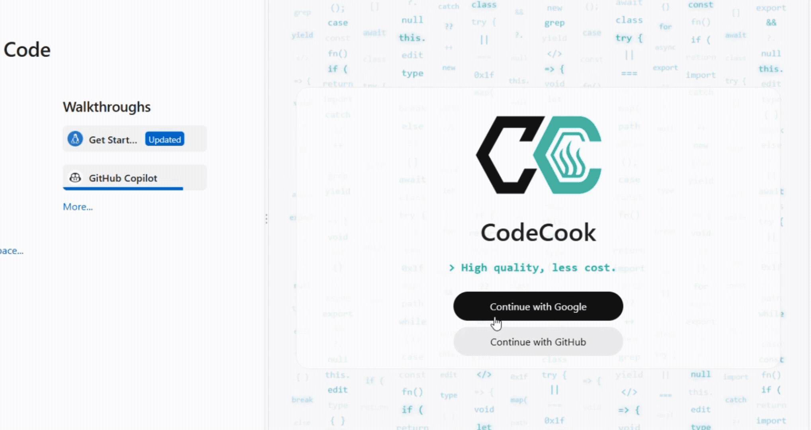
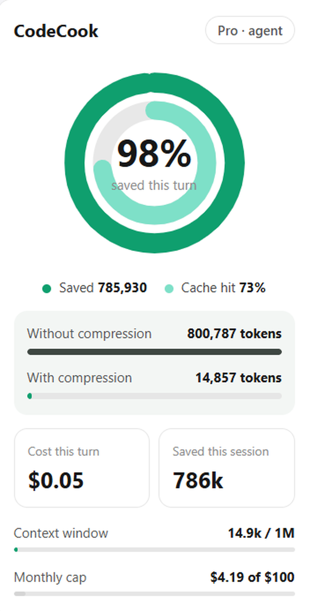
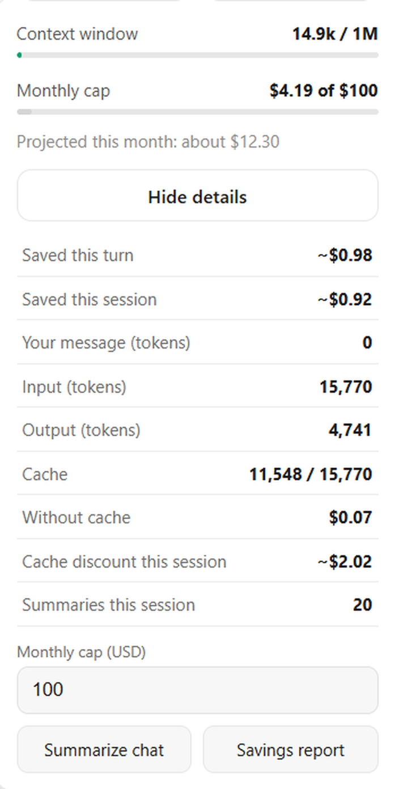

# CodeCook

**Keep the quality. Cut the cost.** A BYOK coding agent for VS Code, Cursor, Antigravity, and compatible editors.

[](https://marketplace.visualstudio.com/items?itemName=makayis.codecook)
[](https://marketplace.visualstudio.com/items?itemName=makayis.codecook)
[](https://open-vsx.org/extension/makayis/codecook)
[](LICENSE)
[](https://github.com/makayis/codecook)



## Install

```bash
code --install-extension makayis.codecook
```

Or install from [VS Marketplace](https://marketplace.visualstudio.com/items?itemName=makayis.codecook) or [Open VSX](https://open-vsx.org/extension/makayis/codecook).

**If CodeCook saved you tokens, a star helps others find it.** ⭐

---

## Why CodeCook

I wanted to spend more time building. Not worrying about tokens.

Long chats resend everything you already paid for: every old message and every tool output, on every turn. The bill keeps growing even when the work doesn't.

CodeCook fixes that at the source. It **summarizes the older turns**, **keeps your plan in reach**, and **shows what each turn will cost**, so you can use the bigger models you actually want.

## How the compression works

CodeCook monitors your context usage. When older messages would exceed the budget threshold (configurable, default 20% of your context window), it runs a summarization pass:

1. **Older turns are compressed** — your recent work stays intact, but earlier messages and tool outputs are replaced with a compact summary
2. **Plans survive** — any active plan remains accessible so the agent stays on track
3. **You keep building** — the next turn uses the compressed history instead of resending everything

The token optimizer shows you the before/after comparison for each turn. One session can save hundreds of thousands of tokens.

## What you get

| | |
| --- | --- |
| **Less repetition** | Older turns and bulky tool output are compressed into a short summary instead of being resent every time. You pay for new work, not old work.<br><br><b>800,787 → 14,857 tokens</b><br>One turn in a long agent session, after CodeCook's compression. That is about <b>98% fewer tokens</b> on that turn, with the plan and the work intact. |
| **Your plan stays in reach** | Plans survive summarization. Build one, reopen it from the command palette, and the agent keeps following it in long sessions. |
| **See the cost** | A token optimizer, savings report, and spend estimates for Gemini Flash and Pro. Set daily, weekly, or monthly caps so a long session never surprises you.<br><br> |
| **Version control for every turn** | Each turn is checkpointed. Review native diffs, keep all edits, revert them, or rewind to an earlier turn and restore your files. |

## Built for real work

- **Chat in the sidebar.** Start a new chat, cancel a running turn, or summarize a long conversation on demand.
- **Review before you commit to anything.** Every changed file is listed. Open one diff, open all diffs, keep all, or revert all.
- **Context from where you work.** Highlight code in the editor, or text in the terminal, and choose **Add to Chat**.
- **Bring your own key.** You pick the provider and pay it directly. No markup and no lock-in.
- **Bigger models, calmer budget.** Smart compression plus visible costs mean you can reach for the strongest model without flinching.

## Works with the models you already use

| Provider | How you connect |
| --- | --- |
| Google Gemini | Google Cloud (Vertex AI) with `gcloud` login, or a Gemini API key |
| OpenAI / ChatGPT | API key, or your ChatGPT plan |
| Anthropic Claude | API key |
| Azure OpenAI | Endpoint and API key |
| AWS Bedrock | Access key, secret, and region |

You only need **one**. Gemini on Vertex AI is the default setup.

## Get started in a minute

1. Install CodeCook and open its icon in the activity bar.
2. Click **Enter** on the welcome screen. Everything stays stored locally in your editor (VS Code, Cursor, Antigravity, etc.).
3. Connect one provider from the table above.
4. If you use Vertex AI, set **Settings → CodeCook → Gcp Project** (`codecook.gcpProject`).
5. Ask the agent to work on your workspace, and review what it changes.

**Requirements:** VS Code, Cursor, Antigravity, or any compatible editor (1.85 or newer), and either a Google Cloud project with Vertex AI (`gcloud auth application-default login`) or an API key for a supported provider.

## Most-used commands

Open the command palette and type **CodeCook** to see them all.

| Command | What it does |
| --- | --- |
| CodeCook: Open Chat | Focus the chat sidebar |
| CodeCook: New Chat | Start a fresh conversation |
| CodeCook: Show Changes | List the current turn's file changes |
| CodeCook: Keep All Changes / Revert All Changes | Accept or undo the turn's edits |
| CodeCook: Token Optimizer | View token usage and savings |

## Settings

| Setting | Purpose |
| --- | --- |
| `codecook.gcpProject` | Google Cloud project for Vertex AI |
| `codecook.gcpLocation` | Vertex AI location (`global` uses the shared endpoint) |
| `codecook.model` | Model used for agent turns |
| `codecook.summaryModel` | Model used to summarize long chats |
| `codecook.spendLimitDailyUsd` | Estimated daily spend cap. `0` means no cap |
| `codecook.spendLimitWeeklyUsd` | Estimated weekly spend cap. `0` means no cap |
| `codecook.spendLimitMonthlyUsd` | Estimated monthly spend cap. `0` means no cap |
| `codecook.usagePing` | Anonymous daily activation ping. `true` sends it. Set `false` to turn it off. |

Token budgets, tool-result limits, and per-million token prices are also configurable under **CodeCook** in Settings.

## Privacy

- Your provider credentials and settings are stored only in your local editor install (VS Code, Cursor, Antigravity, etc.).
- Once a day, when editor telemetry is enabled (in VS Code, Cursor, Antigravity, etc.), CodeCook sends an anonymous activation ping: a random install id, the editor name, and the extension version. It does not include your code, files, prompts, or account. Turn it off with the `codecook.usagePing` setting.

## Contributing

Contributions are welcome! Check out the [good first issues](https://github.com/makayis/codecook/issues?q=is%3Aissue+is%3Aopen+label%3A%22good+first+issue%22) to get started.

## License

Released under the [MIT License](LICENSE).

---

**Spend more time building. Not worrying about tokens.**
